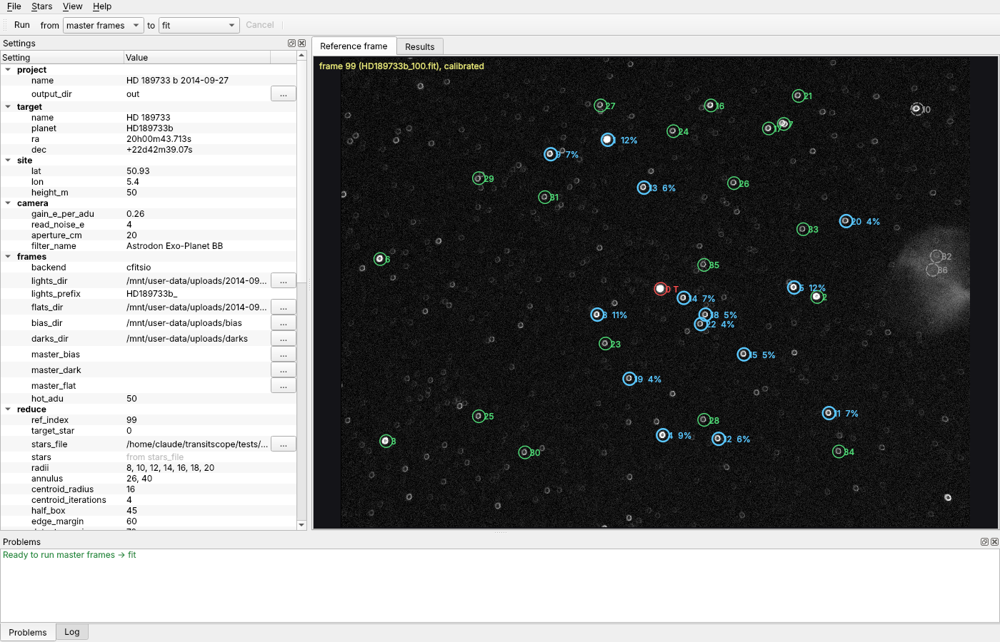
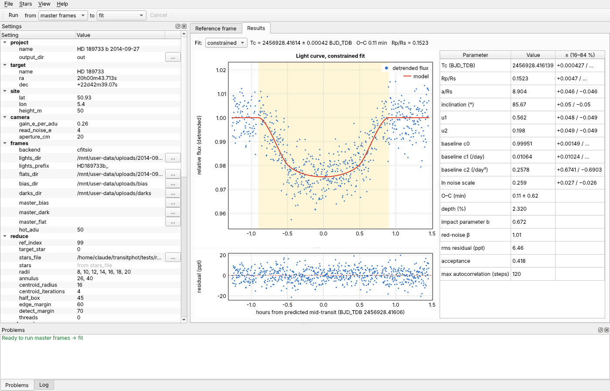

# TransitScope

[](https://github.com/jkobierczynski/TransitScope/actions/workflows/ci.yml)

C++20 exoplanet-transit photometry: calibration → aperture photometry → BJD_TDB timing → comparison-star ensemble light curve → passband limb darkening → MCMC transit fit. No Java, no Python at runtime.

Status: **milestone 5** — the full chain from raw frames to a fitted transit runs in C++, regression-tested stage by stage against the Python reference on the 2014-09-27 HD 189733 b data set. Two interchangeable image backends: CFITSIO and libxisfconv.

## Build

```sh
# Debian/Ubuntu: apt install cmake g++ pkg-config libcfitsio-dev liberfa-dev
# macOS:         brew install cmake pkg-config cfitsio erfa
# Windows:       MSYS2 UCRT64 shell: pacman -S mingw-w64-ucrt-x86_64-{gcc,cmake,ninja,pkgconf,cfitsio}
cmake -S . -B build -DCMAKE_BUILD_TYPE=Release
cmake --build build -j

# no ERFA package (e.g. MSYS2): CMake builds liberfa 2.0.1 from source by itself;
# -DTRANSIT_ERFA_FROM_SOURCE=ON forces that also where a system ERFA exists

# with the libxisfconv backend as well (https://github.com/jkobierczynski/xisfconv, >= 0.25; static or shared build)
PKG_CONFIG_PATH=$XISFCONV_PREFIX/lib/pkgconfig cmake -S . -B build -DTRANSIT_WITH_XISFCONV=ON
```

## Desktop application

```sh
# Qt 6.2 or later: apt install qt6-base-dev | brew install qt (add -DCMAKE_PREFIX_PATH=$(brew --prefix qt))
#                  | MSYS2: pacman -S mingw-w64-ucrt-x86_64-qt6-base
cmake -S . -B build -DTRANSIT_WITH_GUI=ON && cmake --build build -j
build/transitscope-gui myproject.toml
```



- **Settings** (left): every key of the project file, with the template's explanations as tooltips.
  Double-click a value to edit it; the `…` buttons choose folders and files and store them as absolute
  paths. *Save as* turns relative paths into absolute ones, so they keep pointing at the same place. Each change is checked at
  once: **Problems** lists what is wrong or missing (the same checks as `transitscope project check`),
  or says the project is ready to run.
- **Reference frame**: the calibrated reference frame (raw until the master frames exist) with the
  star list; after a run, the comparison stars of the light curve are drawn in blue with their weights.
  Click on a star-free spot to add a star (centroided), right-click a star to make it the
  target, exclude it from the comparison stars or remove it; star indices in the other settings are
  kept consistent. *Stars → Detect stars* replaces the list. An edited list is saved in the project file.
- **Run**: runs the chosen stages (from … to …) in the background with a progress bar; *Cancel*
  stops it. The log shows what each stage wrote. A run gives exactly the files `transitscope run` does.
- **Results**: detrended light curve with the model and the predicted transit window, residuals, and
  the fitted parameters, for either fit. Drag on a plot to zoom, double-click to reset.
  *Export for ExoClock…* and *Export for ETD…* write the light curve for upload and show what to
  choose in the upload form, with a button that opens the upload page.



## Test data

The observation used throughout this README is available for anyone who wants to try TransitScope:
a transit of **HD 189733 b** (near M27) on 2014-09-27, observed by the author.

**[Download the 2014-09-27 HD 189733 b captures (Google Drive)](https://drive.google.com/drive/folders/0B5ahrk9momwbY18taHUwbWdCZEk?resourcekey=0-W6LsPB_5vPOh9zWC_0uPUg)**

| | |
|---|---|
| lights | 718 × 10 s, `HD189733b_001.fit` … `HD189733b_718.fit`, defocused, 20:38–23:21 UTC |
| flats | 31 × 2 s, `flat_*.fit`, in the same folder |
| bias, darks | 40 bias frames and 50 × 10 s darks at −5 °C |
| camera | Atik 314L+ (Sony ICX285AL), 1391 × 1039 px, 16-bit FITS |
| optics | Skywatcher Quattro 800 mm f/4 with TeleVue Paracorr Type 2, Astrodon XOP-BB exoplanet filter |
| size | about 2.4 GB |

Put the frames in folders of your choice, point the folder settings of
`examples/hd189733b_2014-09-27.toml` at them (`lights_dir`, `flats_dir`, `bias_dir`, `darks_dir`) and
run it. With `stars_file = "../tests/ref_stars.csv"` the results should match the tables below
(Tc ≈ 2456928.4161 BJD_TDB, Rp/Rs ≈ 0.152). The frames are plain FITS with the capture software's
own header cards; they contain no observer or site information.

## Use

The easiest way is a project file holding every setting of one observation:

```sh
transitscope project new myproject.toml      # commented example: edit paths, target, ephemeris, star
transitscope project check myproject.toml    # validates it and shows which frames it finds
transitscope run myproject.toml              # masters -> reduce -> lightcurve -> ld -> fit
transitscope run myproject.toml --from lightcurve   # redo later stages after a change (also --to, --only)
```

`examples/hd189733b_2014-09-27.toml` is the 2014 reduction (paths under `~/Pictures`); it gives the
same files as `tests/run_end_to_end.sh`. All outputs go to `output_dir`. Each stage reads the
previous stage's file there, so a run can start at any stage. A typo in a key, a wrong type or a
missing required value stops `check` and `run` with every problem and its line number. The GUI will
read and write the same file.

### Uploading to ExoClock and ETD

```sh
transitscope export myproject.toml --to exoclock     # out/exoclock_<planet>.txt
transitscope export myproject.toml --to etd          # out/etd_<planet>.txt
```

Both files hold the comparison-ensemble light curve of the good frames (not detrended: the databases
fit their own transit model and baseline), as tab-separated time, relative flux and uncertainty
after a `#` header, the layout HOPS writes for these sites. The time is recomputed from each frame's
DATE-OBS:

| | time | upload form |
|---|---|---|
| ExoClock ([exoclock.space/upload](https://www.exoclock.space/upload/)) | JD_UTC, exposure start | Time format JD_UTC, time stamp exposure start, flux format Flux |
| ETD ([var.astro.cz/ETD](https://var.astro.cz/ETD)) | JD_UTC (geocentric), mid-exposure | JD geocentric, brightness in flux |

The planet name and filter in the header come from `[target] planet` and `[camera] filter_name`. The
command prints what to choose in the upload form.

The single commands remain for scripting:

```sh
# masters
transitscope master --type bias --out master_bias.fits bias/bias_*.fit
transitscope master --type dark --out master_dark_10s.fits darks/dark_*.fit
transitscope master --type flat --bias master_bias.fits --out master_flat.fits FLATS_DIR/*.fit   # the flat frames (XOP-BB)

# reduction (one CSV row per frame x star)
transitscope reduce --lights "2014-09-27 HD189733b" --prefix HD189733b_ \
    --dark master_dark_10s.fits --flat master_flat.fits --bias master_bias.fits --hot-adu 50 \
    --ra 20h00m43.713s --dec +22d42m39.07s --lat 50.93 --lon 5.40 --height 50 \
    --ref-index 99 --target 0 --out phot.csv          # or --stars stars.csv; --threads N (default: all cores)

# light curve: quality flags, out-of-transit mask, weighted comparison ensemble,
# aperture + comparison-star choice scored by transit-model residuals, noise model
transitscope lightcurve --phot phot.csv --T0 2454279.436714 --P 2.21857567 --T14 0.07527 \
    --target 0 --exclude-stars 10,32,36 --gain 0.26 --read-noise 4 --aperture-cm 20 --height 50 --out lc.csv

# limb-darkening priors for your passband (filter x camera QE), from the Claret & Bloemen 2011 tables
transitscope ld --teff 5050 --logg 4.59 --feh -0.03 --teff-err 50 --logg-err 0.02 --feh-err 0.08 \
    --filter astrodon_xop_bb --qe sony_icx285al_qe --out ld.json

# MCMC transit fit (affine-invariant ensemble sampler, 40 walkers x 16000 steps by default)
transitscope fit --lc lc.csv --mode constrained --ld-json ld.json --out fit.json --model-csv model.csv   # a/Rs, i with literature priors
transitscope fit --lc lc.csv --mode free        --ld-json ld.json --out fit_free.json                    # a/Rs, i free

# everything above in one go (HD 189733 b set)
tests/run_end_to_end.sh build LIGHTS_DIR FLATS_DIR BIAS_DIR DARKS_DIR OUT_DIR [cfitsio|xisfconv]
#   frames are matched case-insensitively (.fit/.fits/.fts):
#     lights LIGHTS_DIR/HD189733b_*  (set LIGHT_PREFIX=... for other names)
#     flats  FLATS_DIR/*flat*, bias BIAS_DIR/*bias*, darks DARKS_DIR/*dark*
#            (if no file has that word in its name: every FITS file in the folder;
#             for flats only when FLATS_DIR is not the lights folder)
#   THREADS=N limits reduce and fit to N threads (default: all cores)
tests/run_end_to_end.sh build ~/Pictures/HD189733b ~/Pictures/HD189733b/flats ~/Pictures/bias ~/Pictures/darks ~/Pictures/out
```

## Performance

718 frames of 1391 × 1039 px, 37 stars, 7 apertures; 2-core cloud VM:

| stage | 0.2.0 | 0.3.0, 1 thread | 0.3.0, 2 threads |
|---|---|---|---|
| reduce | 42 s | 16.8 s | **8.8 s** |
| master frames (bias, dark, flat) | | 5.2 s | |
| lightcurve | | 1.8 s | |
| fit, 16 000 steps (each mode) | | 82 s | **43 s** |

`reduce` per frame (1 thread): read 7 ms, calibrate 7 ms, centroids 7 ms, measure 8 ms, tracking 0.2 ms.
It runs as a pipeline: worker threads read and calibrate frames ahead, the main thread tracks
the target in sequence (the only serial step), and worker threads measure all stars as soon as a
frame's offset is known. Each frame is read once; about two frames per thread are in memory.
The output CSV is byte-identical for any `--threads` value, with either backend, and identical
to 0.2.0. With more cores, `reduce` should keep scaling until disk reads limit it; the MCMC fit
scales with cores up to half the number of walkers (20).

## Limb darkening

`transitscope ld` computes quadratic limb-darkening coefficients for the actual passband instead of a
standard band. Data files and their provenance are listed in `data/README.md`.

1. Claret & Bloemen (2011) ATLAS tables (v_turb = 2 km/s), trilinear in [Fe/H], Teff, log g, for
   B V R I J g' r' i' z'.
2. Coefficients vs wavelength: piecewise linear through the bands' effective wavelengths.
3. Average over the passband, weighted by detected photons: filter × QE × B_λ(Teff) × λ.
4. Error budget, added in quadrature: L vs F fitting method; wavelength interpolation (leave-one-band-out
   residuals of the bands inside the passband); passband (filter edge ±10 nm, QE tilt ±10 %);
   stellar parameters; and a 0.05 floor for the difference between model atmospheres and measured
   limb darkening.

HD 189733 (Teff 5050 ± 50 K, log g 4.59 ± 0.02, [Fe/H] −0.03 ± 0.08), Astrodon XOP-BB × ICX285AL:

| | value | method | interp | passband | stellar | floor | total σ |
|---|---|---|---|---|---|---|---|
| u1 | 0.524 (L 0.519, F 0.530) | 0.006 | 0.010 | 0.007 | 0.013 | 0.05 | **0.053** |
| u2 | 0.170 (L 0.177, F 0.164) | 0.007 | 0.006 | 0.003 | 0.009 | 0.05 | **0.052** |

The passband's photon-weighted mean wavelength is 670 nm (90 % of the photons in 517–890 nm),
close to Cousins R, so the earlier R-band prior (0.50, 0.19 ± 0.10) was already near; the new prior is
twice as tight. Effect on the 2014-09-27 fit (end-to-end light curve):

| fit | Tc (BJD_TDB) | Rp/Rs | u1 | u2 |
|---|---|---|---|---|
| constrained, R-band prior (0.3.0) | 2456928.41608 ± 0.00043 | 0.1511 ± 0.0048 | 0.574 ± 0.077 | 0.254 ± 0.085 |
| constrained, passband prior (0.4.0) | 2456928.41615 ± 0.00042 | 0.1525 ± 0.0047 | 0.561 ± 0.048 | 0.198 ± 0.048 |
| free, R-band prior | 2456928.41586 ± 0.00045 | 0.1513 ± 0.0061 | 0.484 ± 0.092 | 0.175 ± 0.098 |
| free, passband prior | 2456928.41586 ± 0.00044 | 0.1515 ± 0.0060 | 0.517 ± 0.053 | 0.165 ± 0.051 |

Tc moves by 0.1 min (0.15 σ) and Rp/Rs by 0.3 σ; the limb-darkening posteriors shrink by about 40 %.
`tests/ld/check_ld.py ld.json` re-implements the calculation in numpy (agreement < 1e-6).

Validity: the filter curve is a model (edge at 500 nm, flat beyond) and the QE curve is digitised from the
datasheet graph. Both enter only through the passband term, which is small next to the 0.05 floor.

## Library use

The reduction is a library call, so a GUI or another program needs no CLI:

```cpp
#include "transit/reduce.h"
using namespace transit;

ReduceConfig cfg;
cfg.lights = find_light_frames("2014-09-27 HD189733b", "HD189733b_");
cfg.stars = read_star_list("tests/ref_stars.csv");     // or leave empty: detected on the reference frame
cfg.ref_index = 99;
cfg.target = {parse_ra("20h00m43.713s"), parse_dec("+22d42m39.07s")};
cfg.site = {50.93, 5.40, 50};
const Calibration cal = load_calibration("cfitsio", "master_dark_10s.fits", "master_flat.fits", "master_bias.fits", 50);

ReduceResult r = reduce_sequence(cfg, cal, [](size_t done, size_t total) {
    std::printf("\r%zu/%zu", done, total);
    return true;                                          // false cancels: throws transit::Cancelled
});
PhotTable t = to_phot_table(r);                           // what lightcurve works on; or write_phot_csv(path, r)

EnsembleConfig lc_cfg;                                    // see `transitscope lightcurve` for the fields
lc_cfg.eph = {2454279.436714, 2.21857567, 0.07527};
lc_cfg.score_model.per = lc_cfg.eph.P;
EnsembleResult lc = build_light_curve(t, lc_cfg);

FitConfig fit_cfg;
read_ld_json("ld.json", fit_cfg);                         // or set fit_cfg.u1 / u2 directly
FitData pts = fit_data_from(t, lc);                       // the good frames; or load_fit_data("lc.csv")
FitResult fit = fit_transit(pts, fit_cfg, [](size_t step, size_t steps) {
    return true;                                          // called after every MCMC step; false cancels
});
FitCurves curves = fit_curves(pts.t, pts.f, fit, fit_cfg);  // detrended flux, model, residuals for plotting
// fit.samples: the posterior samples (corner plots); write_fit_json / write_fit_model_csv write the files
```

`tests/gui/gui_test PROJECT.toml` (built with the GUI, runs offscreen with `QT_QPA_PLATFORM=offscreen`)
opens a project and checks star picking, index bookkeeping, validation and saving.
`tests/unit/comp_stability_test phot.csv` checks that the comparison selection does not change when an
unselected star is excluded or the photometry changes slightly (flux noise of 1e-4 to 1e-3).
`tests/unit/project_test` checks the project file (template, round trip, paths, error reports).
`tests/unit/reduce_api_test` and `tests/unit/fit_api_test` check progress reporting, cancelling,
that a callback or the thread count does not change results, and the in-memory tables against the
CSV round trips (both clean under ThreadSanitizer).

## Releases

Pushing a version tag builds, checks and packages TransitScope on all three systems and publishes
a GitHub release (`.github/workflows/release.yml`):

```sh
# set project(transitscope VERSION 0.11.0) in CMakeLists.txt first: the workflow checks they match
git tag v0.11.0 && git push origin v0.11.0
```

| system | download | contents |
|---|---|---|
| Linux x86-64 (Debian 12 / Ubuntu 22.04 and newer) | `TransitScope-0.11.0-x86_64.AppImage` | desktop application |
| | `transitscope-0.11.0-linux-x86_64.tar.gz` | `bin/transitscope`, `bin/transitscope-gui` with their libraries |
| macOS 15+, Apple silicon | `TransitScope-0.11.0-macos-arm64.dmg` | `TransitScope.app` (the CLI is `Contents/MacOS/transitscope`) |
| Windows x86-64 | `transitscope-0.11.0-windows-x86_64.zip` | `bin\transitscope-gui.exe`, `bin\transitscope.exe` with their DLLs |

Each package carries the libraries it needs (made with linuxdeploy, macdeployqt and the MSYS2
DLLs) and the data files; nothing else has to be installed. The programs find their data next to
themselves (`share/transitscope/data`, or `Contents/Resources/data` in the app). The macOS app is
signed ad hoc but not notarized, and the Windows programs are not code-signed, so the first start
needs a confirmation. A release can also be rebuilt for an existing tag from the Actions tab
(*Release → Run workflow*). The packaging scripts are in `packaging/`.

## Continuous integration

`.github/workflows/ci.yml` builds the library, the CLI, the desktop application and the tests on
Linux (GCC with the system ERFA, and Clang with ERFA built from source), macOS (Apple Clang,
Homebrew) and Windows (MSYS2 UCRT64), and runs `tests/ci_checks.sh`. That script needs no image
data: it starts from the Python reference photometry in `tests/reference` and checks the
project file, the ensemble light curve (identical to the reference), the MCMC fit against emcee,
the limb-darkening calculation, the fit API, the stability of the comparison selection and, where
`batman-package` installs, the transit model. Run it locally with `tests/ci_checks.sh build`.
The checks on the frames themselves (`reduce_api_test`, `gui_test`, `run_end_to_end.sh`) need the
test data set and are run by hand.

The MCMC chain for a given seed is the same on every run and thread count, but differs between
C++ standard libraries (libstdc++ / libc++ / MSVC draw their normal deviates differently); the
results agree within the tolerance of `compare_fit.py` (0.2 σ).

## Regression tests

Python (numpy, astropy, batman, emcee) is used only by the test scripts, never at runtime.

```sh
python3 -I tests/compare_reference.py phot.csv tests/reference/phot.npz tests/reference/lc.npz   # photometry + timing
python3 -I tests/unit/check_model_vs_batman.py build/model_dump                                   # transit model
python3 -I tests/npz_to_phot_csv.py tests/reference/phot.npz tests/reference/lc.npz phot_ref.csv  # same input as Python
transitscope lightcurve --phot phot_ref.csv ... --min-improvement 0.002 --out lc.csv   # the reference's selection rule
python3 -I tests/compare_lightcurve.py lc.csv tests/reference/lc.npz 1e-9                         # ensemble
transitscope fit --lc lc.csv --mode constrained --out fit.json
python3 -I tests/compare_fit.py fit.json tests/reference/fitC.json                                # MCMC
```

Photometry and timing (C++ vs Python reference):

| check | result |
|---|---|
| BJD_TDB, ERFA vs astropy | max 0.018 s |
| airmass | max 4e-5 |
| target centroid | max 0.0007 px |
| target flux | median 3e-8 relative; max 3e-4 (one boundary pixel at r = 8 px) |
| ensemble light curve | rms 0.03 mmag, max 0.2 mmag (data scatter: 6.4 mmag) |

Transit model: max |C++ − batman| = 2.4e-8 over 128 parameter sets (Rp/Rs 0.01–1.2, grazing and
full transits, four limb-darkening laws) × 401 times.

Light curve on identical photometry input: same good/out-of-transit masks, same aperture (10 px),
same 13 comparison stars and weights, flux identical to < 1e-9 (with `--min-improvement 0.002`, the
reference's rule; with the default 1 % both photometries keep the same 14 stars).

MCMC (16 000 steps, 3 seeds) vs emcee: every parameter within 0.06 σ of the emcee median, error
bars within 2 %, same autocorrelation times (~120–155 steps).

| fit | Tc (BJD_TDB) | Rp/Rs | O–C |
|---|---|---|---|
| Python reference (emcee), constrained | 2456928.41600 ± 0.00043 | 0.1507 ± 0.0048 | −0.1 ± 0.6 min |
| C++ on the same light curve | 2456928.41600 ± 0.00043 | 0.1508 ± 0.0049 | −0.1 ± 0.6 min |
| C++ end to end from raw frames | 2456928.41608 ± 0.00043 | 0.1511 ± 0.0048 | +0.0 ± 0.6 min |

The end-to-end run differs by 0.2 σ: with its own photometry the old 0.2 % selection rule kept one
more star (14 instead of 13). Since 0.10.0 (1 % rule) both photometries select the same 14 stars.

## Backend comparison (CFITSIO 4.3.1 vs libxisfconv 0.25.0)

`fitscompare` on the HD 189733 b lights, flats, bias and dark frames, the float32 master frames, and the
edge-case set from `tests/make_fits_edge.py` (uint16/BZERO, int16 with negatives, int16 with BSCALE,
int32, float32 with NaN, float64, multi-extension with a table in between, Rice tile-compressed `.fz`,
3-plane cube; cards with an embedded quote, a CONTINUE long string, HIERARCH, logical, empty string,
COMMENT/HISTORY):

- pixels bit-identical in every file (max |Δ| = 0), image numbering identical (tables skipped)
- every non-structural card identical in type and value; structural cards (BITPIX, NAXISn, BZERO, …)
  are absent from libxisfconv's keyword list by design and reported separately
- **one difference: BLANK.** For an int16 image with `BLANK = -999`, CFITSIO returns NaN for the
  blank pixel; libxisfconv returns −999.0 (mapping "16-bit signed with negative values -> Float32").
- `transitscope reduce --backend xisfconv` on all 718 frames gives a CSV byte-identical to the CFITSIO run.
- Read speed (718 lights, uint16 with BZERO, warm cache, one thread): CFITSIO 2.2 ms/frame; libxisfconv
  1.5 ms/frame since 0.4.5 (the reader takes rows in 64-row bands with `xisfconv_read_rows` instead of
  loading the whole image and copying it twice). With an unpatched libxisfconv 0.25.0 it is 3.6 ms/frame;
  the rest of the gap was a byte-by-byte byte swap in the library (patch: fixed-width swaps).

See `docs/ARCHITECTURE.md` for the module layout and roadmap.

## Licence

GPL-3.0-or-later (see `LICENSE`). libxisfconv is LGPL-3.0-or-later, CFITSIO and ERFA are permissive;
toml++ 3.4.0 (MIT, `third_party/tomlplusplus`, header-only, bundled) reads the project files.
The desktop application uses Qt 6 (LGPL-3.0).
All are compatible with this licence.
